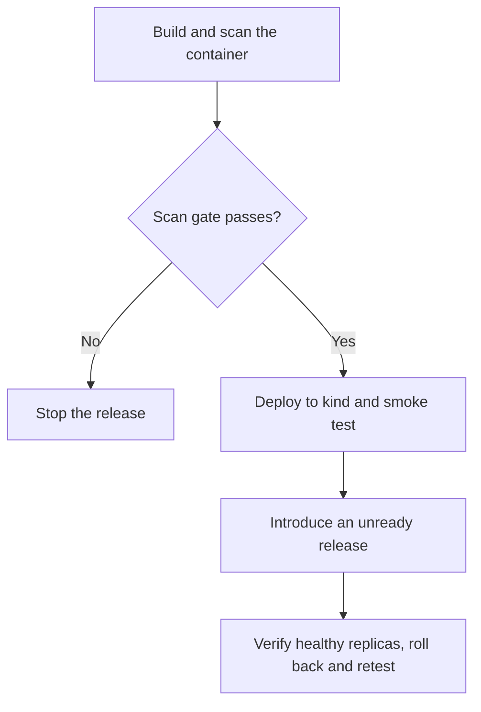

# Azure CI/CD and Kubernetes reliability

A DevSecOps and SRE portfolio by Anvesh Polasa. These labs show how a release is validated, how a bad rollout is detected, and how recovery is verified.

| Lab | What to review | Verification |
| --- | --- | --- |
| **Kubernetes release and recovery** | [Lab instructions](https://github.com/anveshpolasa-wisetech/Azure-Cloud-Platform-infra-CICD/tree/release-recovery-lab/labs/release-recovery) · [Azure DevOps YAML](https://github.com/anveshpolasa-wisetech/Azure-Cloud-Platform-infra-CICD/blob/release-recovery-lab/labs/release-recovery/azure-pipelines.yml) · [Draft PR #1](https://github.com/anveshpolasa-wisetech/Azure-Cloud-Platform-infra-CICD/pull/1) | Local Robot Framework checks passed for healthy, unready, and restored service processes. Hosted container and cluster results are tracked in the PR. |
| **Kubernetes runbook assistant** | [Lab instructions](https://github.com/anveshpolasa-wisetech/Azure-Cloud-Platform-infra-CICD/tree/runbook-assistant-guardrails/labs/runbook-assistant) · [Draft PR #2](https://github.com/anveshpolasa-wisetech/Azure-Cloud-Platform-infra-CICD/pull/2) | Eight local tests passed. The Ollama adapter was tested against a simulated endpoint. |

## Release and recovery workflow

## Engineering decisions

- **Scan what gets deployed.** Trivy checks the built image before the image enters the disposable cluster. The pipeline publishes the scan and test results.
- **Verify recovery at the endpoint.** The lab checks rollout status and the readiness configuration, then reruns the smoke suite against the service.
- **Keep troubleshooting read-only.** The FastAPI assistant returns curated Kubernetes notes and citations. Its optional local model selects among retrieved topics, and the API validates the selection.

## More work

- [Azure enterprise architecture](https://github.com/anveshpolasa-wisetech/azure-enterprise-architecture)
- [Linux troubleshooting scenarios](https://github.com/anveshpolasa-wisetech/linux-interview-scenarios)
- [Portfolio roadmap and upstream references](PORTFOLIO.md)
